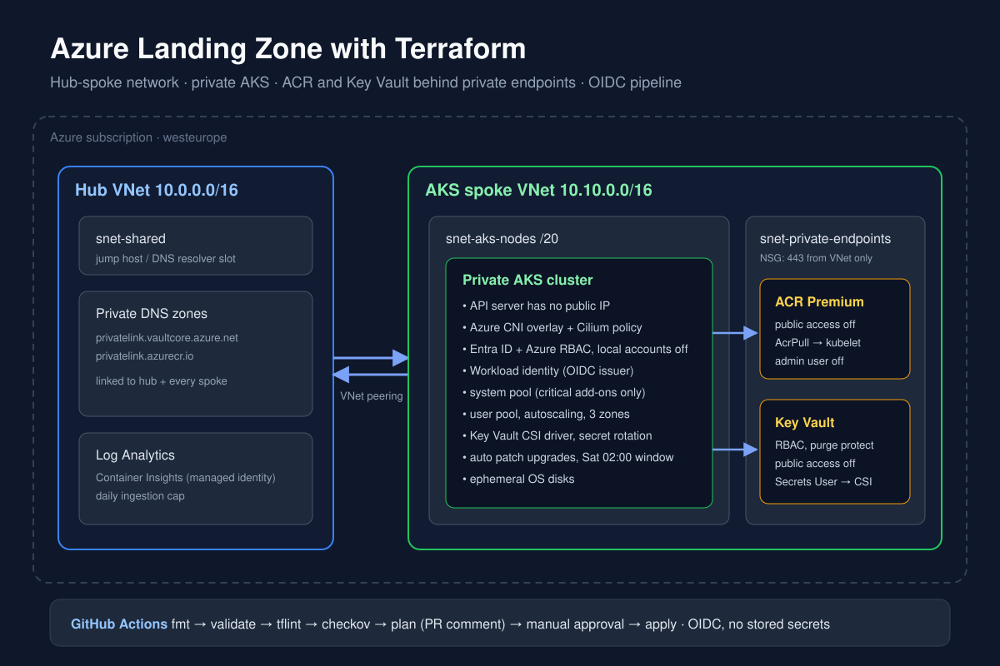

# Azure landing zone with Terraform

A production-style starting point for running containers on Azure: a hub-spoke network, a private AKS cluster, and a container registry and Key Vault that are reachable only over private endpoints. Everything is Terraform, and the pipeline deploys with OIDC, so no cloud credentials are stored in GitHub.



## What it builds

| Area | Resources | Decisions |
|---|---|---|
| Network | Hub VNet, AKS spoke VNet, two-way peering, NSGs | Private endpoints get their own subnet with an NSG that only allows HTTPS from the VNet |
| DNS | `privatelink.vaultcore.azure.net`, `privatelink.azurecr.io` | Zones live in the hub and are linked to every VNet, so name resolution works from anywhere in the estate |
| AKS | Private cluster, system and user node pools | No public API, Entra ID + Azure RBAC with local accounts disabled, workload identity, Azure Policy, Cilium network policy, host encryption, three zones, automatic patch upgrades in a maintenance window |
| Registry | ACR Premium | Public access and admin user off; the kubelet identity gets `AcrPull` only |
| Secrets | Key Vault | RBAC mode, purge protection, public access off; the CSI driver identity gets `Key Vault Secrets User` only |
| Monitoring | Log Analytics | Container Insights through managed identity, with a daily ingestion cap to protect the budget |

## Layout

```
modules/
  vnet/              VNet, subnets, optional NSG per subnet
  private-endpoint/  private endpoint + DNS zone group
  aks/               private AKS cluster and user node pool
  acr/               registry + private endpoint + AcrPull assignments
  keyvault/          vault + private endpoint + least-privilege roles
envs/
  dev/               composes the modules for one environment
.github/workflows/
  terraform.yml      fmt, validate, tflint, checkov, plan on PR, gated apply on main
```

Adding `test` or `prod` means copying `envs/dev`, changing the variables (for example `aks_sku_tier = "Standard"`) and pointing at a different state key.

## Run it

Prerequisites: Terraform 1.7+, Azure CLI, a storage account for remote state, and the `EncryptionAtHost` feature registered on the subscription (`az feature register --namespace Microsoft.Compute --name EncryptionAtHost`).

```bash
az login
export ARM_SUBSCRIPTION_ID=<subscription-id>

cd envs/dev
cp backend.hcl.example backend.hcl            # fill in your state storage account
cp terraform.tfvars.example terraform.tfvars  # set your admin group ID
terraform init -backend-config=backend.hcl
terraform plan
terraform apply
```

Because the cluster is private, reach it from inside the network (a jump host in `snet-shared`, a VPN) or with `az aks command invoke`:

```bash
az aks command invoke -g rg-platform-dev-weu-workload -n aks-platform-dev-weu --command "kubectl get nodes"
```

## Pipeline

`terraform.yml` runs on every pull request:

1. `terraform fmt -check` and `terraform validate`
2. `tflint` with the azurerm ruleset
3. `checkov` security scan (exceptions are documented in [docs/checkov-exceptions.md](docs/checkov-exceptions.md))
4. `terraform plan`, posted as a comment on the PR

On `main`, the saved plan is applied after a reviewer approves the `dev` environment.

To enable plan and apply, create an Entra ID app with a federated credential for this repository, then set these repository variables: `AZURE_CLIENT_ID`, `AZURE_TENANT_ID`, `AZURE_SUBSCRIPTION_ID`, `TFSTATE_RG`, `TFSTATE_SA`. Without them, only the static checks run.

## Cost notes

For a dev environment, the Free AKS tier, a 5 GB/day Log Analytics cap and a small user pool keep the bill low. Premium ACR is the largest fixed cost; it is required for private endpoints.
